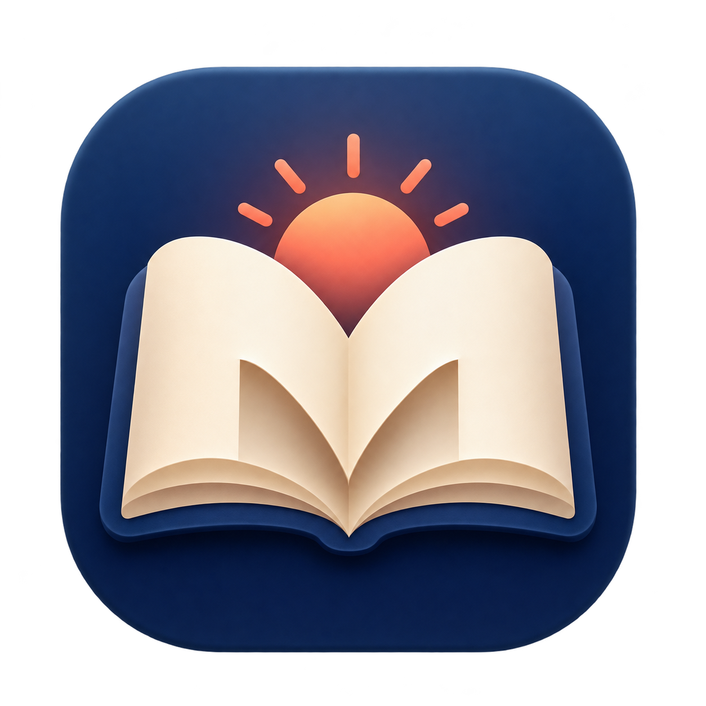

<div align="center">
  

  # Morrow

  **A beautiful little home for your Markdown.**

  Open a `.md` file, settle into a clean reading view, and make changes whenever inspiration strikes.

  [Download for macOS](https://github.com/erwinbierens/Morrow/releases/tag/v0.2.0) · [Explore the source](https://github.com/erwinbierens/Morrow)
</div>

---

## Read, write, keep moving

| | |
| --- | --- |
| 📖 **Enjoy the reading** | Turn plain Markdown into a spacious page with light and dark modes. |
| ✍️ **Edit with confidence** | Write in a split view while the preview updates beside you. Save in place or save a copy. |
| ☑️ **Make progress visible** | Click task checkboxes in the preview to update the Markdown source. |
| 📋 **Take it anywhere** | Copy rendered text or the full source, and preview Markdown from your clipboard. |
| 🔄 **Stay current** | Check for a new GitHub release from inside Morrow. |

## Get started

1. Download **Morrow.pkg** from the [latest release](https://github.com/erwinbierens/Morrow/releases).
2. Run the installer, then open **Morrow** from Applications.
3. Choose **Open File** or press **⌘O** to open a Markdown file.

**macOS says “Morrow.pkg Not Opened”?** This preview installer is not yet notarized. After trying to open it, choose **Done**, then open **System Settings → Privacy & Security**. Scroll to **Security**, click **Open Anyway** for Morrow, and confirm **Open**. macOS may ask for your password. The option is available for about an hour after the blocked attempt. Only do this for the package you downloaded from this repository. See [Apple's instructions](https://support.apple.com/en-us/102445).

Need a quick look at some text? **Paste Markdown** (⌘⇧V) opens a preview of what's on your clipboard. To change a document, choose **Edit**; the source and preview appear side by side.

### Everyday shortcuts

| Action | Shortcut |
| --- | --- |
| New document | ⌘N |
| Open file | ⌘O |
| Save | ⌘S |
| Save as | ⌘⇧S |
| Reload open file | ⌘R |
| Paste Markdown | ⌘⇧V |
| Copy source | ⌘⇧C |

Select rendered text and press **⌘C** to copy what you see. The moon button switches between light and dark mode.

### Check things off

```md
- [ ] Draft the idea
- [x] Make a start
- [*] Keep the momentum
```

Morrow displays all three as interactive tasks; `[*]` is read as checked. Click a checkbox to change its marker in the Markdown source, then save the file to keep the change.

## Updates

Morrow looks for a newer GitHub release when it opens. You can also use **Updates** to check manually. When a newer version is available, Morrow downloads `Morrow.pkg`, checks it against the SHA-256 digest published by GitHub, and opens the macOS installer for you to finish the update.

## Build from source

Morrow is written in **SwiftUI** and renders Markdown with macOS's **cmark-gfm** library. Install Xcode Command Line Tools, then run:

```sh
zsh build.sh
zsh package.sh
```

The included installer was built for Apple Silicon and tested on macOS 27.2. This preview supports standard CommonMark; Markdown tables and local images are not yet supported. The app is signed locally for testing, while the installer is unsigned and not notarized. macOS may ask you to allow it through **Privacy & Security → Open Anyway**.

---

Made with care at [Studio Sjas Patat](https://sjaspatat.com).
